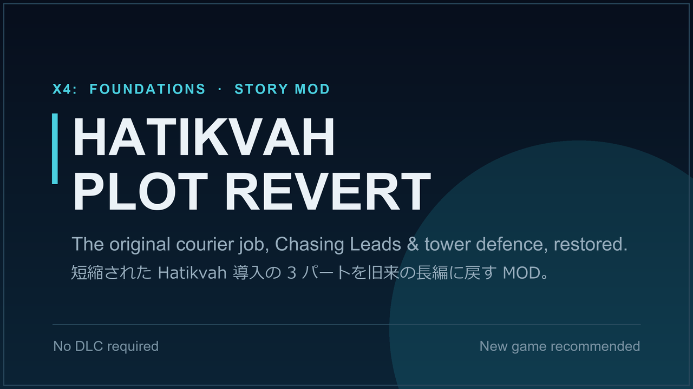

# Hatikvah Plot Revert (X4: Foundations)

Restores the original, longer intro to the Hatikvah "Trade Revolution" plot that X4 later streamlined.

**Steam Workshop:** https://steamcommunity.com/sharedfiles/filedetails/?id=3758424511

## What it restores

Three early phases of the Hatikvah story are quietly skipped by the current game. This mod brings them back, in their original order:

- The opening courier/delivery job, which rewards you with a small freighter of your own.
- "Chasing Leads" - a surveillance mission tailing a suspected Scale Plate Pact ship.
- "A Parting Gift" - a station-defence job where you deploy laser towers.

Everything else in the plot is left untouched.

## Requirements

- X4: Foundations 7.00 or later (no DLC needed)

**Recommended:** start a new game. In-progress saves that have already passed the intro are not affected.

As an unsigned script mod, the game runs in [Modified] mode while it is active.

## Installation

- **Steam Workshop:** subscribe on the Workshop page above.
- **Manual:** copy `content.xml` and `md/` into `X4 Foundations/extensions/x4_hatikvah_revert/`.

## How it works

The current game still contains all three phases in `md/story_diplomacy_intro.xml`; they are just skipped. `md/story_diplomacy_intro.xml` in this repository is an XML `<diff>` patch on that vanilla script with three operations:

1. The condition of the `Skip_Pt1_v2` cue is forced to false, so the opening delivery job runs normally.
2. `Pt3_End` signals `Pt4_Follow_Ship` again instead of jumping straight to `Pt5_The_Meeting`.
3. `Pt6_Destroy_Drones_End` signals `Pt7_Station_Defences` again instead of jumping straight to `Pt8_TheAgreement`.

Each restored phase ends by signalling the next one as originally designed. The patch is a pure diff, and savegames do not depend on the mod (`save="false"`), so it can be removed at any time.

## Contributing

Issues and pull requests are welcome. There is no build step: the mod is a single MD diff patch.

To test changes, copy the files into your `extensions` folder as described above. If you are also subscribed on the Workshop, disable that copy while testing so the game does not load two mods with the same ID. Starting X4 with `-debug all -logfile debuglog.txt` writes script and patch errors to `Documents/Egosoft/X4/<id>/debuglog.txt`.

Code comments are mostly in Japanese; English comments in contributions are perfectly fine.

## License

[MIT](LICENSE). This covers the files in this repository only.

X4: Foundations is a trademark of Egosoft GmbH. This is an unofficial fan-made mod and is not affiliated with or endorsed by Egosoft.

## 日本語

短縮された Hatikvah「Trade Revolution」プロット導入を、旧来の長い形に戻す MOD です。現在は飛ばされている3つのフェイズ（報酬で小型貨物船がもらえる配達任務、「Chasing Leads」、「A Parting Gift」）を本来の順序で復活させます。詳しくは Steam Workshop のページ（日本語の説明あり）をご覧ください。Issue やプルリクエストは日本語でも歓迎です。
